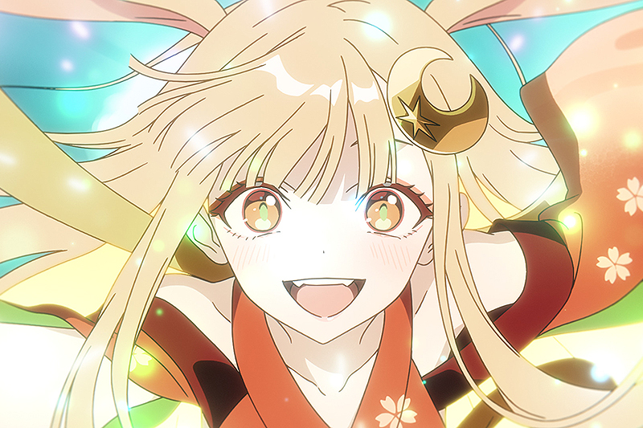

<p align="center">
  
</p>

<h1 align="center">Kaguya Client</h1>

<p align="center">
  
  
  
  
</p>

<p align="center"><strong>A Mixin-based Minecraft Forge 1.8.9 mod. Press <code>Right Shift</code> to open the ClickGUI, and type <code>.help</code> in chat to list commands.</strong></p>

<p align="center">Based on Myau.</p>

## Download

Download the latest version from **[GitHub Releases](https://github.com/xKobayashiChan/Kaguya/releases)**.

## Installation

1. Make sure Java 8 (64-bit) is installed
2. Download and run the installer for [Forge 1.8.9](https://files.minecraftforge.net/net/minecraftforge/forge/index_1.8.9.html)
3. Open your `.minecraft` folder, create a `mods` folder, and put `KaguyaClient-vX.X.X.jar` inside
4. Open the Minecraft launcher, select the Forge 1.8.9 profile, and start the game
5. Log in on the login screen that appears at startup (an account linked to your HWID is required)

## Features

All modules can be toggled and configured from the ClickGUI (`Right Shift`) or with chat commands.

<details>
  <summary>Combat</summary>

### Combat

AimAssist, AntiFireball, AutoClicker, BackTrack, Criticals, Disabler, Displace, Freeze, HitBox, HitSelect, KillAura, KnockbackDelay, LagRange, MoreKB, NoHitDelay, Reach, Refill, TargetStrafe, Timer, TimerRange, Velocity, WTap

</details>

<details>
  <summary>Movement</summary>

### Movement

AntiAFK, AntiVoid, Blink, Eagle, Fly, Jesus, KeepSprint, LongJump, NoFall, NoJumpDelay, NoSlow, SafeWalk, Speed, Sprint, Zenith

</details>

<details>
  <summary>Render</summary>

### Render

- **ESP** - ESP, BedESP, ChestESP, ItemESP, Chams, Tracers, NameTags, Xray, Trajectories, Radar
- **HUD** - HUD, ClientHUD, TargetHUD, Health, Indicators, ClosestPlayerHUD, TeamClosestPlayerHUD, FriendHUD
- **Visual** - Camera, Cape, FriendTransparency, FullBright, NoHurtCam, HideClientText
- **ClickGui** - Opens the module menu (default key: `Right Shift`)

</details>

<details>
  <summary>Player</summary>

### Player

AntiDebuff, AutoBlockIn, AutoHeal, AutoTool, AutoWater, ChestStealer, FastPlace, GhostHand, InvManager, InvWalk, MCF, Scaffold, SpeedMine

</details>

<details>
  <summary>Misc</summary>

### Misc

- **Bed Wars** - BedNuker, BedTracker, AntiObbyTrap
- **Players** - Denick, NickHider, HeldItemDetect, LightningTracker
- **Chat** - ChatCopy, Spammer, AntiObfuscate
- **Utility** - AutoAnduril, InventoryClicker, NoRotate, FlagDetector, PacketListener, ServerLag, AuthSync
- **Discord Rich Presence** - Shows Kaguya Client as your Discord status

</details>

<details>
  <summary>Account Manager</summary>

### Account Manager

- Microsoft login, token login, and session login from an in-game GUI
- Switch between saved accounts without restarting the game

</details>

## Commands

Commands start with `.` and are typed in chat.

| Command | Aliases | Description |
|---|---|---|
| `.help` | `.commands` | List all commands |
| `.list` | `.l`, `.modules` | List all modules |
| `.toggle <module>` | `.t` | Toggle a module |
| `.<module> [setting] [value]` | | Show or change a module's settings |
| `.bind <module> <key>` | `.b` | Bind a module to a key |
| `.config <save\|load> <name>` / `.config list\|folder` | `.cfg`, `.c` | Manage configs (saved in `config/Myau/`) |
| `.friend <add\|remove\|list\|clear> [names...]` | `.f` | Manage friends |
| `.target <add\|remove\|list\|clear> [name]` | `.enemy`, `.e` | Manage targets |
| `.hide <module>` / `.show <module>` | `.h` / `.s`, `.unhide` | Hide or show a module in the HUD |
| `.cname <name\|reset>` | `.cn` | Change the client name |
| `.nick set <name>` / `.nick clear` | `.n` | Register or clear your nick |
| `.denick <name>` | | Look up the real name behind a nick |
| `.ign` | `.name`, `.username` | Copy your username to the clipboard |
| `.item` | `.itemname` | Show the held item's name |
| `.players` | `.playerlist` | Show players in the lobby |
| `.cc` | | Copy a chat message to the clipboard |
| `.vclip <distance>` | | Teleport vertically |

## Building

```bat
gradlew.bat build
```

The jar is output to `build/libs/`. The version is set by `version = "vX.X.X"` in `build.gradle`.

## Credits

- Myau - base client
- ksyz - account manager

## License

See [LICENSE.md](LICENSE.md).
